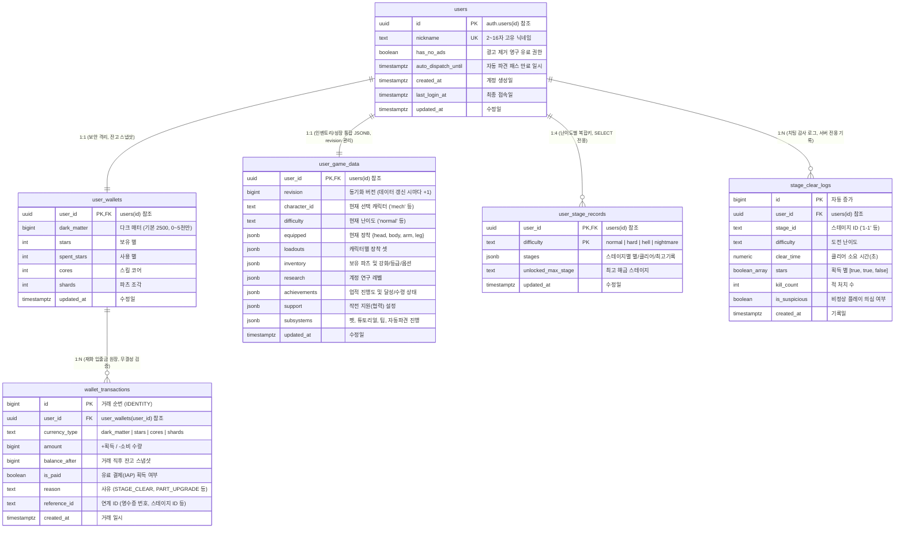

# 데이터베이스 테이블 및 통신 아키텍처 설계서 (Database Architecture)

- **작성 일자**: 2026-11-01
- **최종 개정**: 2026-11-01 (Codex 검토 수용 및 단일 트랜잭션 RPC 통신 규격 확정)
- **데이터베이스 환경**: Supabase (PostgreSQL 15+, Region: `ap-northeast-2`)
- **프로젝트 명**: Mad Overlord (`zbprmbooxbymihwdhijn`)

---

## 1. 데이터베이스 설계 원칙 및 전략

### 1) 보안 우선 분리 및 RLS 쓰기 전면 통제 (Security & RLS Lockdown)
- **모든 경제 데이터 직접 쓰기 금지 (P0)**:
  - 재화(`user_wallets`)뿐 아니라 인벤토리/강화/연구(`user_game_data`), 스테이지 진행도(`user_stage_records`)에 대해서도 **클라이언트의 직접 `INSERT/UPDATE/DELETE` 권한을 전면 차단**하고 오직 본인 조회(`SELECT`)만 허용합니다.
  - 브라우저 콘솔(`F12`)이나 REST API 패킷 조작을 통해 임의로 파츠 10강을 만들거나 스테이지를 클리어 처리하는 것을 원천 차단합니다.
  - 모든 상태 변경은 **검증된 서버 DB Function (RPC)**을 통해서만 수행됩니다.

### 2) 단일 트랜잭션 RPC 패턴 및 트래픽 최소화 (Atomic Batch RPC & Min Traffic)
- **전투 종료 시 연쇄 변경 단일화 (Atomic Batch)**:
  - 스테이지 클리어 시 일어나는 5단계 과정(스테이지 기록 갱신 + 재화 지급 + 거래 원장 영수증 + 업적 진행/달성 + 치팅 감사 로그)을 클라이언트가 쪼개서 통신하지 않고, **단 1회의 서버 RPC(`settle_battle`) 트랜잭션(`BEGIN ... COMMIT`)**으로 일괄 처리합니다.
  - 처리 중 오류 발생 시 전체 롤백(All-or-Nothing)되어 데이터 불일치 버그를 원천 차단합니다.
  - 응답 시에도 전체 데이터를 다시 SELECT할 필요 없이, **서버가 계산한 최신 변경분(변경된 잔고, 갱신된 스테이지, 달성된 업적 ID)만 묶어 단 1회 응답(1~2KB)**하여 네트워크 트래픽을 85% 이상 절감합니다.

### 3) 실무형 멱등성 및 오버엔지니어링 배제 (Pragmatic Architecture)
- **최초 보상 중복 수령 방지**:
  - 불필요한 별도 테이블(`reward_claims`)을 증설하지 않고, 기존 `stages` / `achievements` 상태 필드 + RPC 트랜잭션 원자성으로 중복 수령을 100% 방지합니다.
  - 재화 지급 시 `wallet_transactions`에 `reference_id`로 자동 영수증이 기록되어 이중 증빙을 제공합니다.
- **유료 권한 경량화**:
  - 거창한 별도 권한 테이블 대신 `users` 테이블에 직관적인 컬럼(`has_no_ads`, `auto_dispatch_until`)을 두어 조인 비용과 트래픽을 없앱니다.
- **다기기 덮어쓰기 방지 (`revision`)**:
  - `user_game_data`에 `revision BIGINT`를 두어 데이터 변경 시마다 +1 증가시켜 오래된 기기의 데이터가 최신 상태를 덮어쓰지 못하도록 보장합니다.

---

## 2. ER 다이어그램 (Entity-Relationship Diagram)



---

## 3. 테이블 상세 명세서

### 3.1. `public.users` (유저 프로필 및 유료 권한)
- **RLS 정책**:
  - `users_select_all`: 랭킹 조회를 위해 누구나 조회 가능 (`USING (true)`).
  - `users_update_own`: 닉네임 변경 RPC 등으로 제한. (유료 권한 컬럼은 클라이언트 직접 수정 불가)

| 컬럼명 | 타입 | Nullable | 기본값 / 제약조건 | 설명 |
|---|---|:---:|---|---|
| `id` | `UUID` | NO | PK, `REFERENCES auth.users(id) ON DELETE CASCADE` | 유저 고유 식별자 |
| `nickname` | `TEXT` | YES | `UNIQUE`, `CHECK (length >= 2 AND length <= 16)` | 유저 닉네임 |
| `has_no_ads` | `BOOLEAN` | NO | `DEFAULT FALSE` | 광고 제거 유료 상품 소유 여부 |
| `auto_dispatch_until`| `TIMESTAMPTZ`| YES | `DEFAULT NULL` | 자동 파견 패스 만료 일시 |
| `created_at` | `TIMESTAMPTZ` | NO | `NOW()` | 계정 생성 시각 |
| `last_login_at` | `TIMESTAMPTZ` | NO | `NOW()` | 마지막 로그인 시각 |
| `updated_at` | `TIMESTAMPTZ` | NO | `NOW()` | 정보 수정 시각 |

---

### 3.2. `public.user_wallets` (핵심 재화 잔고)
- **RLS 정책**: `SELECT`만 본인(`auth.uid() = user_id`)에게 허용. **직접 `UPDATE` 차단**.

| 컬럼명 | 타입 | Nullable | 기본값 / 제약조건 | 소스코드 매핑 |
|---|---|:---:|---|---|
| `user_id` | `UUID` | NO | PK, `REFERENCES public.users(id) ON DELETE CASCADE` | 소유 유저 ID |
| `dark_matter` | `BIGINT` | NO | `2500`, `CHECK (0 <= dark_matter <= 50000000)` | `gameState.darkMatter` |
| `stars` | `INT` | NO | `0`, `CHECK (stars >= 0)` | 보유 특수 별 |
| `spent_stars` | `INT` | NO | `0`, `CHECK (spent_stars >= 0)` | `progressGrowth.spentStars` |
| `cores` | `INT` | NO | `0`, `CHECK (cores >= 0)` | `progressGrowth.cores` |
| `shards` | `INT` | NO | `0`, `CHECK (shards >= 0)` | `progressGrowth.shards` |
| `updated_at` | `TIMESTAMPTZ` | NO | `NOW()` | 재화 변경 시각 |

---

### 3.3. `public.wallet_transactions` (재화 입출금 원장)
- **RLS 정책**: `SELECT`만 본인 허용. 서버 RPC 트랜잭션에서 자동 INSERT.

| 컬럼명 | 타입 | Nullable | 기본값 / 제약조건 | 설명 |
|---|---|:---:|---|---|
| `id` | `BIGINT` | NO | PK, `GENERATED ALWAYS AS IDENTITY` | 거래 일련번호 |
| `user_id` | `UUID` | NO | FK, `REFERENCES public.user_wallets(user_id) ON DELETE CASCADE` | 대상 유저 ID |
| `currency_type` | `TEXT` | NO | `CHECK (in ('dark_matter','stars','cores','shards'))` | 재화 종류 |
| `amount` | `BIGINT` | NO | - | 변동량 (양수: 획득, 음수: 소비) |
| `balance_after`| `BIGINT` | NO | `CHECK (balance_after >= 0)` | 거래 직후 잔고 스냅샷 |
| `is_paid` | `BOOLEAN` | NO | `DEFAULT FALSE` | 유료 결제(IAP) 획득 여부 |
| `reason` | `TEXT` | NO | - | 거래 사유 (`STAGE_CLEAR`, `UPGRADE`, `IAP` 등) |
| `reference_id` | `TEXT` | YES | `NULL` | 외부 연계 키 (영수증 ID, 스테이지ID, 업적ID) |
| `created_at` | `TIMESTAMPTZ` | NO | `NOW()` | 거래 발생 시각 |

* **인덱스**: `idx_wallet_tx_user_created ON (user_id, created_at DESC)`

---

### 3.4. `public.user_game_data` (인벤토리 및 성장 통합)
- **RLS 정책**: **[P0 보안 조치]** 본인 `SELECT`만 허용. **직접 `UPDATE` 차단** (서버 RPC 전용).

| 컬럼명 | 타입 | Nullable | 기본값 / 제약조건 | 설명 |
|---|---|:---:|---|---|
| `user_id` | `UUID` | NO | PK, `REFERENCES public.users(id) ON DELETE CASCADE` | 소유 유저 ID |
| `revision` | `BIGINT` | NO | `DEFAULT 1` | 동기화 버전 번호 (변경 시마다 +1) |
| `character_id` | `TEXT` | NO | `'mech'` | 현재 선택 대표 캐릭터 |
| `difficulty` | `TEXT` | NO | `'normal'` | 현재 선택 난이도 |
| `equipped` | `JSONB` | NO | 기본 4부위 레드 로봇 파츠 JSON | 현재 장착 파츠 |
| `loadouts` | `JSONB` | NO | `'{}'::JSONB` | 캐릭터별 저장된 장착 셋 |
| `inventory` | `JSONB` | NO | `'{}'::JSONB` | 보유 파츠 및 강화/등급/옵션 |
| `research` | `JSONB` | NO | `'{}'::JSONB` | 계정 연구 트리 레벨 |
| `achievements` | `JSONB` | NO | `'{}'::JSONB` | 업적 진행도 및 달성/수령 상태 |
| `support` | `JSONB` | NO | 협력 기본 설정 JSON | 작전 지원(협력) 설정 |
| `subsystems` | `JSONB` | NO | 서브시스템 JSON | 펫, 튜토리얼, 팁, 자동파견 상태 |
| `updated_at` | `TIMESTAMPTZ` | NO | `NOW()` | 최종 갱신 시각 |

---

### 3.5. `public.user_stage_records` (난이도별 진행 기록)
- **RLS 정책**: **[P0 보안 조치]** 본인 `SELECT`만 허용. **직접 `UPDATE` 차단** (서버 RPC 전용).

| 컬럼명 | 타입 | Nullable | 기본값 / 제약조건 | 설명 |
|---|---|:---:|---|---|
| `user_id` | `UUID` | NO | PK (복합키 1), `REFERENCES public.users(id) ON DELETE CASCADE` | 유저 ID |
| `difficulty` | `TEXT` | NO | PK (복합키 2), `CHECK (in ('normal','hard','hell','nightmare'))` | 난이도 구분 |
| `stages` | `JSONB` | NO | `'{}'::JSONB` | 스테이지별 기록 `{"1-1": {stars, cleared, best_time}}` |
| `unlocked_max_stage` | `TEXT` | NO | `'1-1'` | 현재 난이도 최고 해금 스테이지 |
| `updated_at` | `TIMESTAMPTZ` | NO | `NOW()` | 기록 갱신 시각 |

---

### 3.6. `public.stage_clear_logs` (감사 로그)
- **RLS 정책**: 유저 직접 접근 금지 (서버 RPC 함수 내부에서 `SECURITY DEFINER`로만 기록).

| 컬럼명 | 타입 | Nullable | 기본값 / 제약조건 | 설명 |
|---|---|:---:|---|---|
| `id` | `BIGINT` | NO | PK, `GENERATED ALWAYS AS IDENTITY` | 로그 일련번호 |
| `user_id` | `UUID` | YES | `REFERENCES public.users(id) ON DELETE SET NULL` | 유저 ID |
| `stage_id` | `TEXT` | NO | - | 클리어한 스테이지 ID ('1-1', '4-B') |
| `difficulty` | `TEXT` | NO | - | 도전 난이도 ('normal' 등) |
| `clear_time` | `NUMERIC(7,2)`| NO | `CHECK (clear_time >= 0)` | 클리어 소요 시간 (초) |
| `stars` | `BOOLEAN[]` | NO | `ARRAY[false, false, false]` | 획득 별 배열 |
| `kill_count` | `INT` | NO | `0` | 적 처치 수 |
| `is_suspicious` | `BOOLEAN` | NO | `FALSE` | 비정상 소요 시간 의심 플래그 |
| `created_at` | `TIMESTAMPTZ` | NO | `NOW()` | 기록 시각 |

---

## 4. 핵심 트랜잭션 RPC 통신 규격 (표준 API)

클라이언트는 개별 테이블을 건드리지 않고 아래의 **3대 단일 RPC**만 호출하여 트래픽을 최소화하고 완벽한 원자성을 유지합니다.

### 4.1. 로그인 초기 로드: `get_user_bootstrap()`
- **호출 시점**: 게임 시작/로그인 완료 시 **단 1회 호출**
- **기능**: 유저 프로필, 지갑 잔고, 인벤토리/성장/업적, 스테이지 기록 전체를 단일 JSON 스냅샷으로 일괄 반환.
- **반환 데이터 예시**:
  ```json
  {
    "user": { "id": "...", "nickname": "오버로드_1234", "has_no_ads": false, "auto_dispatch_until": null },
    "wallet": { "dark_matter": 2500, "stars": 0, "cores": 0, "shards": 0 },
    "game_data": { "revision": 12, "character_id": "mech", "inventory": {...}, "achievements": {...} },
    "stages": { "normal": {...}, "hard": {...} }
  }
  ```

---

### 4.2. 전투 정산: `settle_battle(p_payload)`
- **호출 시점**: 스테이지 클리어/종료 시 **단 1회 호출**
- **전송 페이로드**:
  ```json
  {
    "request_key": "uuid-v4",
    "stage_id": "1-1",
    "difficulty": "normal",
    "clear_time": 42.5,
    "kill_count": 14,
    "stars": [true, true, true]
  }
  ```
- **서버 내부 트랜잭션 실행 순서**:
  1. **멱등성 검사**: `request_key`가 이미 처리되었으면 기존 성공 결과 즉시 반환 (중복 지급 차단).
  2. **치팅 검증**: `clear_time`이 스테이지 최소 소요 시간(예: 15초) 미만인지 검사 ➔ 비정상이면 의심 플래그 설정.
  3. **스테이지 기록 갱신**: `user_stage_records` 별/클리어 여부 병합.
  4. **신규 별/클리어 보상 계산**: 기존에 안 받았던 신규 별에 대해서만 보너스 DM 계산 ➔ `user_wallets` 잔고 증가.
  5. **원장 영수증 기록**: `wallet_transactions`에 `reason: 'STAGE_CLEAR', reference_id: '1-1'`로 1행 기록.
  6. **업적 진행도 갱신**: 누적 처치수, 스테이지 클리어 업적 카운트 증가 ➔ `user_game_data.achievements` 갱신 및 `revision + 1`.
  7. **감사 로그 기록**: `stage_clear_logs`에 1행 INSERT.
- **응답 (단 1~2KB 변경분만 반환)**:
  ```json
  {
    "success": true,
    "earned": { "dark_matter": 1200, "stars": 2 },
    "wallet": { "dark_matter": 3700, "stars": 2 },
    "stage_update": { "stars": [true, true, true], "cleared": true },
    "completed_achievements": ["kill_100"],
    "revision": 13
  }
  ```

---

### 4.3. 파츠 강화 및 구매: `upgrade_part(p_part_id, p_request_key)`
- **호출 시점**: 연구소에서 파츠 강화 버튼 클릭 시 **단 1회 호출**
- **서버 내부 트랜잭션 실행 순서**:
  1. `user_game_data`에서 파츠 소유 여부 및 현재 레벨 확인.
  2. 최대 레벨(10강) 초과 여부 확인 및 강화 비용(DM) 산출.
  3. `user_wallets` 잔고가 충분한지 확인 후 차감 (`dark_matter = dark_matter - cost`).
  4. `wallet_transactions`에 `reason: 'PART_UPGRADE', reference_id: p_part_id`로 영수증 1행 기록.
  5. `user_game_data.inventory` 내 파츠 레벨 +1 갱신 및 `revision + 1`.
  6. "파츠 N회 강화" 업적 카운트 자동 증가.
- **응답**:
  ```json
  {
    "success": true,
    "cost": 600,
    "new_level": 4,
    "wallet": { "dark_matter": 3100 },
    "revision": 14
  }
  ```
