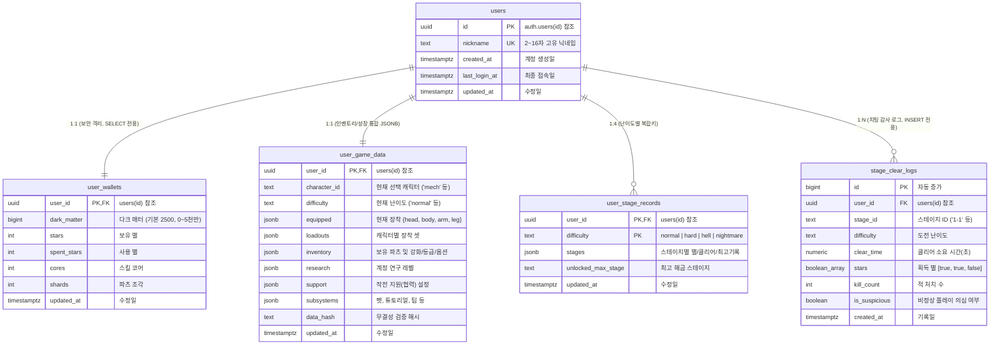

# 데이터베이스 테이블 설계서 (Database Architecture)

- **작성 일자**: 2026-11-01
- **데이터베이스 환경**: Supabase (PostgreSQL 15+, Region: `ap-northeast-2`)
- **프로젝트 명**: Mad Overlord (`zbprmbooxbymihwdhijn`)
- **적용 상태**: Supabase SQL Editor 실행 및 5개 테이블/트리거/RLS 활성화 완료

---

## 1. 데이터베이스 설계 원칙 및 전략

### 1) 보안 우선 분리 (Security Isolation)
- 치팅의 1순위 표적이 되는 **재화(`user_wallets`)**는 일반 게임 데이터와 엄격히 분리합니다.
- 클라이언트에 의한 임의 수정을 차단하기 위해 **RLS(Row Level Security)에서 `UPDATE` 권한을 박탈**하고, 오직 `SELECT`만 허용합니다. (재화 변경은 추후 서버 RPC 함수로만 가능)

### 2) 트래픽 및 쿼리 최적화 (JSONB De-normalization)
- 파츠 수십 개, 캐릭터별 장착 셋, 연구 트리 등을 개별 테이블(12~15개)로 정규화하면 로그인 시 10회 이상의 REST API 호출이 발생하여 트래픽과 지연시간이 폭증합니다.
- 이를 방지하기 위해 **`user_game_data`** 테이블의 **`JSONB` 컬럼에 압축 집약**하여, **로그인 시 단 1~2회의 쿼리로 유저의 모든 인벤토리와 세팅을 일괄 로드**할 수 있도록 설계했습니다.

### 3) 감사 및 치팅 방지 로그 (Audit Trail)
- **`stage_clear_logs`** 테이블은 유저에게 `INSERT`만 허용하고 `SELECT/UPDATE/DELETE`를 금지하여, 0.1초 클리어 등 비정상 패킷을 사후 감사할 수 있는 무결성 로그를 보장합니다.

---

## 2. ER 다이어그램 (Entity-Relationship Diagram)

---

## 3. 테이블 상세 명세서

### 3.1. `public.users` (유저 프로필 및 계정 메타)
- **목적**: `auth.users` 시스템 계정과 1:1로 매핑되는 공개 프로필 정보. 랭킹 및 닉네임 관리.
- **RLS 정책**:
  - `users_select_all`: 인증된 모든 유저가 닉네임/프로필 조회 가능 (`USING (true)`).
  - `users_update_own`: 본인 행만 닉네임 및 접속일 수정 가능 (`auth.uid() = id`).

| 컬럼명 | 타입 | Nullable | 기본값 / 제약조건 | 설명 |
|---|---|:---:|---|---|
| `id` | `UUID` | NO | PK, `REFERENCES auth.users(id) ON DELETE CASCADE` | 유저 고유 식별자 |
| `nickname` | `TEXT` | YES | `UNIQUE`, `CHECK (length >= 2 AND length <= 16)` | 유저 닉네임 (중복 불가) |
| `created_at` | `TIMESTAMPTZ` | NO | `NOW()` | 계정 최초 생성 시각 |
| `last_login_at` | `TIMESTAMPTZ` | NO | `NOW()` | 마지막 로그인 시각 |
| `updated_at` | `TIMESTAMPTZ` | NO | `NOW()` | 정보 수정 시각 (트리거 갱신) |

---

### 3.2. `public.user_wallets` (핵심 재화 테이블)
- **목적**: 다크 매터(DM), 별(Star), 코어, 조각 등 게임 내 모든 화폐의 원자적 관리.
- **보안 제약**:
  - `dark_matter`: 0 이상 50,000,000 이하 음수 방지 및 상한선 제약.
  - 모든 재화 컬럼 음수 방지 (`CHECK >= 0`).
- **RLS 정책**:
  - `user_wallets_select_own`: 본인 데이터만 조회 가능 (`auth.uid() = user_id`).
  - **UPDATE 정책 없음**: 클라이언트에서 직접 REST API로 금액 변경 시 **403 Forbidden** 차단.

| 컬럼명 | 타입 | Nullable | 기본값 / 제약조건 | 소스코드 매핑 |
|---|---|:---:|---|---|
| `user_id` | `UUID` | NO | PK, `REFERENCES public.users(id) ON DELETE CASCADE` | 소유 유저 ID |
| `dark_matter` | `BIGINT` | NO | `2500`, `CHECK (0 <= dark_matter <= 50000000)` | `gameState.darkMatter` |
| `stars` | `INT` | NO | `0`, `CHECK (stars >= 0)` | 보유 특수 별 |
| `spent_stars` | `INT` | NO | `0`, `CHECK (spent_stars >= 0)` | `progressGrowth.spentStars` |
| `cores` | `INT` | NO | `0`, `CHECK (cores >= 0)` | `progressGrowth.cores` |
| `shards` | `INT` | NO | `0`, `CHECK (shards >= 0)` | `progressGrowth.shards` |
| `updated_at` | `TIMESTAMPTZ` | NO | `NOW()` | 재화 변경 시각 |

---

### 3.3. `public.user_game_data` (인벤토리 및 성장 데이터 통합)
- **목적**: 유저당 1행으로 모든 인벤토리, 장착, 연구를 보관하여 네트워크 트래픽을 90% 이상 절감.
- **RLS 정책**:
  - `user_game_data_select_own`: 본인 데이터 조회 (`auth.uid() = user_id`).
  - `user_game_data_insert_own` / `update_own`: 본인 데이터 등록 및 갱신 허용.

| 컬럼명 | 타입 | Nullable | 기본값 / 제약조건 | 설명 (내부 JSON 구조 예시) |
|---|---|:---:|---|---|
| `user_id` | `UUID` | NO | PK, `REFERENCES public.users(id) ON DELETE CASCADE` | 소유 유저 ID |
| `character_id` | `TEXT` | NO | `'mech'` | 현재 선택된 대표 캐릭터 ID |
| `difficulty` | `TEXT` | NO | `'normal'`, `CHECK (in ('normal','hard','hell','nightmare'))` | 현재 선택 난이도 |
| `equipped` | `JSONB` | NO | 기본 4부위 레드 로봇 파츠 JSON | `{"head":"red_head", "body":"red_body", "arm":"red_arm_r", "leg":"red_leg"}` |
| `loadouts` | `JSONB` | NO | `'{}'::JSONB` | 캐릭터별 저장된 장착 셋 `{"mech": {...}, "hero": {...}}` |
| `inventory` | `JSONB` | NO | `'{}'::JSONB` | 보유 파츠 및 강화/등급/옵션 `{"part_id": {"lv": 3, "grade": "rare", "opts": [...]}}` |
| `research` | `JSONB` | NO | `'{}'::JSONB` | 계정 연구 트리 레벨 `{"support_opt": 2, "shard_boost": 1}` |
| `support` | `JSONB` | NO | 협력 기본 설정 JSON | `{"character": null, "auto": false, "random": false, "helpSeen": false}` |
| `subsystems` | `JSONB` | NO | 서브시스템 JSON | `{"tips": ["tip_first"], "pets": {}, "tutorial": {"step": 2}}` |
| `data_hash` | `TEXT` | YES | `NULL` | 클라이언트 데이터 위변조 방지용 무결성 해시 |
| `updated_at` | `TIMESTAMPTZ` | NO | `NOW()` | 최종 저장 시각 |

---

### 3.4. `public.user_stage_records` (난이도별 진행 기록)
- **목적**: 스테이지 진행도와 별 달성 현황을 난이도별 1행(총 4행)으로 보관.
- **RLS 정책**:
  - 본인 데이터 조회, 등록, 수정 허용 (`auth.uid() = user_id`).

| 컬럼명 | 타입 | Nullable | 기본값 / 제약조건 | 설명 |
|---|---|:---:|---|---|
| `user_id` | `UUID` | NO | PK (복합키 1), `REFERENCES public.users(id) ON DELETE CASCADE` | 유저 ID |
| `difficulty` | `TEXT` | NO | PK (복합키 2), `CHECK (in ('normal','hard','hell','nightmare'))` | 난이도 구분 |
| `stages` | `JSONB` | NO | `'{}'::JSONB` | 스테이지별 기록 `{"1-1": {"stars": [true,true,true], "cleared": true, "best_time": 42.5}}` |
| `unlocked_max_stage` | `TEXT` | NO | `'1-1'` | 현재 난이도에서 해금된 최고 스테이지 |
| `updated_at` | `TIMESTAMPTZ` | NO | `NOW()` | 기록 갱신 시각 |

---

### 3.5. `public.stage_clear_logs` (감사 로그)
- **목적**: 스테이지 클리어 결과 감사 로그. 0.1초 클리어 등 치트 유저 식별용.
- **RLS 정책**:
  - `stage_clear_logs_insert_own`: 본인은 오직 새 로그를 **`INSERT`**만 가능.
  - 조회(SELECT), 수정(UPDATE), 삭제(DELETE) 권한을 막아 로그 조작 방지.

| 컬럼명 | 타입 | Nullable | 기본값 / 제약조건 | 설명 |
|---|---|:---:|---|---|
| `id` | `BIGINT` | NO | PK, `GENERATED ALWAYS AS IDENTITY` | 로그 고유 순번 |
| `user_id` | `UUID` | YES | `REFERENCES public.users(id) ON DELETE SET NULL` | 유저 식별자 |
| `stage_id` | `TEXT` | NO | - | 클리어한 스테이지 ID ('1-1', '4-B') |
| `difficulty` | `TEXT` | NO | - | 도전 난이도 ('normal' 등) |
| `clear_time` | `NUMERIC(7,2)`| NO | `CHECK (clear_time >= 0)` | 클리어 소요 시간 (초 단위 소수점) |
| `stars` | `BOOLEAN[]` | NO | `ARRAY[false, false, false]` | 획득한 3성 여부 배열 |
| `kill_count` | `INT` | NO | `0` | 적 처치 수 |
| `is_suspicious` | `BOOLEAN` | NO | `FALSE` | 비정상 소요 시간 등 의심 플래그 |
| `created_at` | `TIMESTAMPTZ` | NO | `NOW()` | 로그 생성 시각 |

---

## 4. 데이터베이스 함수 및 자동 트리거

### 1) 타임스탬프 갱신 트리거 (`handle_updated_at`)
- `users`, `user_wallets`, `user_game_data`, `user_stage_records` 테이블에 `UPDATE` 발생 시 `updated_at` 컬럼을 현재 시각(`NOW()`)으로 자동 갱신.

### 2) 회원가입 자동 초기화 트리거 (`handle_new_user_init`)
- `auth.users`에 신규 계정(익명 로그인 또는 소셜/이메일 가입)이 등록되면 즉시 실행되는 `SECURITY DEFINER` 트리거 함수.
- 실행 내용:
  1. `public.users`: 임시 닉네임(`오버로드_XXXX`)으로 기본 프로필 자동 생성.
  2. `public.user_wallets`: 기본 자금 **2,500 DM** 지급 행 자동 생성.
  3. `public.user_game_data`: 기본 로봇 파츠 세팅 및 노말 난이도 기본값 생성.
  4. `public.user_stage_records`: 노말 난이도 최고 해금 스테이지(`1-1`) 기본 행 생성.
