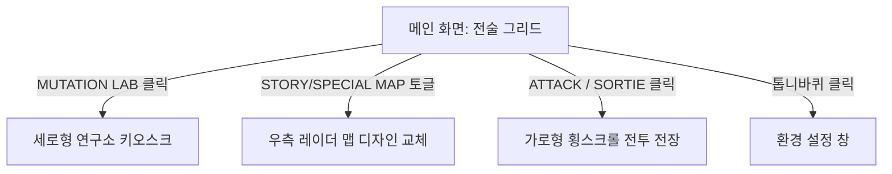
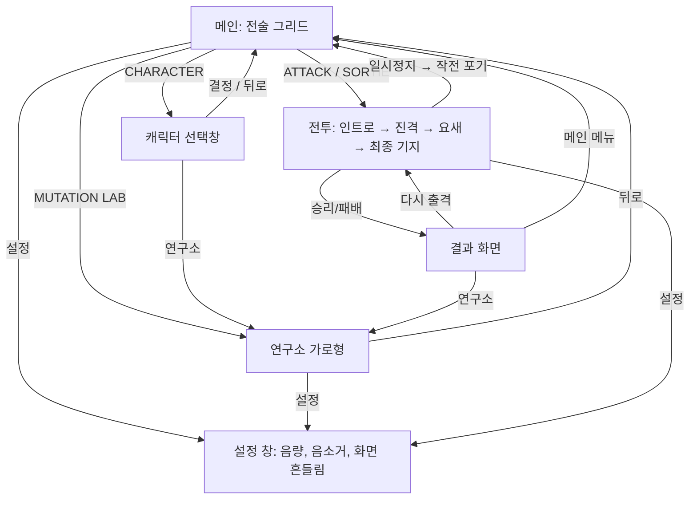

# 메인 화면 UI/UX 기획서 (Main Menu UI/UX Specification)

이 문서는 프로젝트 **매드 오버로드 (MAD OVERLORD)**의 메인 전술 화면의 UI/UX 설계 및 레이아웃 배치안을 명세합니다.

---

## 1. 개편된 전술 그리드 레이아웃 (Tactical Grid Layout v2)

V의 피드백을 반영하여 복잡한 메뉴 바를 배제하고, 좌측의 몬스터 관리 영역과 우측의 전장 맵 타겟팅 영역으로 직관화한 설계안입니다.

### 🖼️ 시안 이미지 참조
* **[최종 개편 시안 B v2](file:///e:/Project/SelfMovingGame/MD/ui_draft_b_v2.png)**
* **[초기 디자인 시안 B v1](file:///e:/Project/SelfMovingGame/MD/ui_draft_b_v1.png)**

---

## 2. 화면 영역별 구성 명세

### ① 좌측 패널: 오버로드 대기실 (Overlord Showroom)
* **몬스터 Live2D 모델링**: 현재 조립/장착된 파츠가 결합된 완성형 몬스터가 숨쉬기(Idle) 모션으로 렌더링됩니다.
* **[MUTATION LAB] 버튼**: 
  - 위치: 몬스터 모델링 바로 하단.
  - 기능: 클릭 시 세로형 연구실 파츠 장착 및 스탯 강화 키오스크 화면으로 줌인 전환됩니다.

### ② 우측 패널: 홀로그램 전술 레이더 (Tactical Radar Map)
* **홀로그램 전장 지도**: 현재 구역의 성을 중심으로 공격 타겟 포인트와 거점 도달 경로가 표시됩니다.
* **스테이지 맵 토글 버튼 (2종)**:
  - **[STORY MAP]**: 시나리오 전개를 위한 기본 1-1, 1-2 등 스토리 진격 맵 활성화.
  - **[SPECIAL MAP]**: 타임어택이 배제된 성장용 '무제한 파밍 스테이지' 및 보스 레이드 랭킹전용 '엘리트 챌린지 스테이지' 맵 활성화.

### ③ 하단 중앙: 작전 출격 통제 패널 (Main Action Panel)
* **[협력 출격] 버튼** (2026-10-26, D-087): ATTACK 왼쪽에 편성한 캐릭터의 얼굴·이름·간략 효과를 표시한다. 수동 Q 문구는 생략한다. 미선택이며 편성 가능한 후보가 있을 때만 은은한 빛 효과로 선택을 유도한다(동작 줄이기 설정에서는 고정 강조). 후보가 없으면 캐릭터 해금·보유 파츠 4부위 조건을 안내한다. 편성 창에서는 선택된 캐릭터만 밝은 테두리·배경 및 **✓ 선택됨** 배지를 표시한다.
* **[ATTACK / SORTIE] 버튼**:
  - 위치: 화면 중앙 최하단.
  - 디자인: 빗금 형태의 노란색/검은색 위험(Warning) 공사 스트라이프 무늬로 제작하여 시각적 강조 극대화.
  - 기능: 클릭 시 선택한 스테이지 가로형 횡스크롤 전투 전장으로 출격합니다.

### ④ 우상단: 설정 및 정보 영역 (Utility & Top Bar)
* **세재화 정보**: 보유하고 있는 일반 재화 및 특수 재화 인디케이터.
* **[세팅] 버튼 (톱니바퀴 아이콘)**: 
  - 기존 하단 푸터 바에 있던 복잡한 세팅 버튼을 우상단으로 깔끔하게 통합하여 화면 개방감을 높였습니다.

---

## 2-1. 가로형 적용 (2026-09-30, D-010) — 현재 구현

시안 B v2(세로 구성)를 **가로 1280x720**으로 옮겼다. 코드: `js/ui_v2/menu_v2.js`, `radar_v2.js`, `lab_v2.js`, `ui_v2.css` 8·9장.

**메인 화면**
| 위치 | 구성 |
|---|---|
| 위 | 왼쪽 문장·게임 이름 / 오른쪽 DM, 설정(톱니바퀴) |
| 왼쪽 패널 ① | 캐릭터 이름·팩션(머리표 UNIT READY / 몸통이 없으면 NO BODY), 리그 캐릭터(대기 동작, 안 산 부위는 흐리게), 부위별 설명(머리·팔·몸통·다리: 파츠 이름 + 스킬), 능력치 4개, **CHARACTER**(선택창) · **MUTATION LAB** 버튼 |
| 오른쪽 패널 ② | 전술 레이더(지형 등고선, 회전 탐지선, 진격 경로, 목표·적 신호), STORY / SPECIAL MAP 전환 (SPECIAL은 준비 중으로 잠금 → 출격 버튼 꺼짐). 레이더 머리에 **구역 탭**(구역 1 / 구역 2, 잠긴 구역은 자물쇠 — 누르면 "잠김" 안내), 고른 구역의 스테이지 점만 표시 (2026-10-03, D-041) → **2026-11-04 STORY MAP = RPG 지도**(`stageMap_v2.js`): 구역 탭 없이 좌우로 밀어 구역 넘김, 정거장마다 NPC, 누르면 캐릭터가 걸어감, 난이도 단추는 머리 줄 (D-104·D-107). 레이더는 SPECIAL(준비 중) 화면에만 |
| 아래 ③ | **ATTACK / SORTIE** 버튼(몸통이 없으면 막힘 — "출격 불가" 안내), 상태 줄(DM, 장착 스킬, 출격 가능 여부) |

**캐릭터 선택창** (2026-10-14, D-051)
| 위치 | 구성 |
|---|---|
| 위 | 뒤로(메인), 제목, DM, 설정 |
| 가운데 | 캐릭터 카드 4장(새 캐릭터와 합치면 8장): 영문 태그·이름, 리그 캐릭터(그 캐릭터의 장착, 안 산 부위는 흐리게), 소개 한 줄, 능력치 3개, 스킬 1·2·필살기·패시브, 보유 파츠 수, 출격 가능 / 연구소에서 몸통 구매. 누르면 바로 그 캐릭터로 바뀜(SELECTED) |
| 아래 | 고른 캐릭터·보유 파츠·안내, **연구소**, **결정**(메인 화면) |

**연구소** (기획서의 "세로형 키오스크"를 가로형으로)
| 위치 | 구성 |
|---|---|
| 위 | 뒤로(메인), 제목, DM, 설정 |
| 왼쪽 | 개조 미리보기: 고른 파츠로 조립한 리그 캐릭터 (캐릭터는 선택창에서 고른 캐릭터, 안 산 부위는 흐리게) |
| 가운데 | 능력치 비교(현재 → 개조 후, ▲▼), 스킬 구성(스킬 1·2·필살기·패시브, 바뀌면 NEW) |
| 오른쪽 | 부위 탭(머리·몸통·팔·다리) + 파츠 카드(부위 그림, 캐릭터 색, 세트, 능력치, 부여 스킬, 가격·장착 상태) — **고른 캐릭터의 파츠만, [파츠제거] 없음** (D-051) |
| 아래 | 변경 수, 개조 비용, 개조 후 잔액, 되돌리기, **개조 확정** |

**전투 화면**: HUD(유닛 카드, 진행도, 거점 체력, 스킬 도크, 일시정지·배속), 연출(인트로, 경고, 컷인, 파괴, 결과 화면). 일시정지 메뉴에 설정.

> 협력 호출 현재 설정(D-075): 첫 충전·재충전은 각각 30초이며, HUD·편성·상세 안내도 공통 설정을 따른다.

**협력 출격 HUD** (2026-10-22, D-072·D-073): **좌측 상단 주인공 상태창 바로 아래** 350px 가로형 카드. 64px 팔각 초상화에 충전 부채꼴·남은 초·Q 단축키를 표시한다. 옆에는 이름과 간략 상태(`첫 충전 / 재충전 / 호출 가능 / 대상 대기 / 지원 중`), 다음 줄에 간략 효과, 아래에 효과 상세·독립 자동 토글을 배치한다. 상태 옆 초 표시는 제거하고 남은 시간은 버튼 안에만 둔다. **효과 상세**를 누르면 같은 상단 자리에서 카드 대신 요약·필살기·전체 효과·시너지·보스 예외를 펼친다. 높이 230px 이내·내부 스크롤로 주인공·거점/보스 바·기존 스킬을 가리지 않는다. 상세가 열리면 가려진 카드 조작을 숨기고 닫기로 포커스를 옮긴다. 닫기/바깥 클릭/Escape로 닫으며, 닫기/Escape 후 상세 버튼으로 포커스를 돌려준다. 설명 열기는 호출이나 일시정지를 유발하지 않는다. 첫 충전/재충전 30초(D-075)·5초 출격 규칙을 따른다. 규칙은 [협력모드 컨셉](../concepts/협력모드.md).

**전장 그림** (2026-10-01, C단계): 거점은 그림(요새 220px · 최종 기지 280px, 왼쪽 끝 x 720 — 오른쪽 아래 스킬 도크에 가리지 않는 위치), 체력 50% 이하 파손 그림, 파괴 시 잔해. 적은 리그를 구운 걷기·공격 스프라이트(일반 92px, 방패병 103px, 보스 196px). 배경은 구역 1 연구소 3층(탱크 홀 1280px · 기계 띠 640px 반복 · 바닥 256px 반복, 바닥 높이 76px), 보스전은 붉은 경보 조명 판. 외형 기준은 [아트_설정.md](아트_설정.md).

---

## 2-2. 모바일 가독성 시안 (2026-10-31, Q-015 → 2026-11-03 **메인 B · 게임 A 적용, D-099**)

**문제**: 1280×720 화면을 통째로 줄이는 방식이라 휴대폰 가로(800×360)에서 배율 0.49 → 13px 글자가 약 6px. 실측(헤드리스 Chrome) 결과 메인 화면 글자 497자 중 87%, 전투 화면 글자 196자 전부가 실제 8px 미만. 기본 스킬 버튼은 지름 약 40px, 20:9 폰 양옆 약 80px는 빈 공간.

**공통 기준 (제안)**: 휴대폰 실제 크기로 글자 최소 11px·중요한 숫자 14px 이상(= 1280×720 설계 기준 22px·28px 이상), 누르는 것 44px 이상, 영문 장식 문구는 로고 한 곳만, 같은 정보는 한 화면에 한 번, 설명은 '눌러서 보기'로.

| 화면 | 시안 | 핵심 | 보이는 글자 |
|---|---|---|---|
| 메인 | 현재 | — | 497자 |
| 메인 | **A** 배치 유지 | 영문 장식 문구 삭제, 부위 설명 → 스킬 아이콘 4개, 능력치 이름 → 아이콘, 구역 탭 10개 → '구역 1 ▾', 아래 상태 줄 삭제 | 92자 |
| 메인 | **B** 캐릭터 중심 | 왼쪽 아이콘 메뉴(캐릭터·연구소·상점·지원·펫), 오른쪽 스테이지 카드 + 엄지 자리 출격, 레이더 지도·파츠 상세는 눌렀을 때 | 87자 |
| 게임 | 현재 | — | 196자 |
| 게임 | **A** 아이콘 HUD | 자리 유지, 얼굴 + 체력 숫자, 진행 막대에 요새·기지 아이콘, 전황 문장·일반 적 이름표·빈 협력 글 삭제, 스킬 56px·필살기 72px | 35자 |
| 게임 | **B** 양옆 레일 HUD | 20:9 폰 양옆 여백에 HUD를 모두 옮김(전장 가림 없음), 16:9 기기는 A로 | 39자 |

- 캔버스(나란히 비교 + 메모): <https://claude.ai/artifact/DKmeAEmtg6M9kQSDXNcsm5>
- 그림: [메인 현재](모바일가독성_시안/메인_현재.jpg) · [메인 A](모바일가독성_시안/메인_시안A.jpg) · [메인 B](모바일가독성_시안/메인_시안B.jpg) · [게임 현재](모바일가독성_시안/게임_현재.jpg) · [게임 A](모바일가독성_시안/게임_시안A.jpg) · [게임 B](모바일가독성_시안/게임_시안B.jpg)
- 추천 순서: 게임 A → 메인 B(바로 고칠 땐 A) → 게임 B는 20:9 폰 전용으로 나중에.

**적용 (2026-11-03, D-099) — '휴대폰 배치'** (코드: 휴대폰 전용 `ui_v2_mobile.css`(D-103, PC는 `ui_v2.css`), `js/main_v2.js` fitScreens, `menu_v2.js`, `battleHud_v2.js`)
- 켜짐 (D-102): **휴대폰·태블릿(앱이거나 터치가 주 입력)이면 자동으로 휴대폰 배치, 마우스로 하는 PC는 창 크기와 상관없이 위 2-1 예전 배치.** 설정 '화면 / 조작 → 화면 배치'(자동·휴대폰·PC) 또는 주소 `?ui=mobile`·`?ui=pc`로 고정(PC에서 미리 보기). (처음 D-099는 배율 0.65 미만 기준이었음)
- 크기 기준: 휴대폰 가로에서 배율이 약 0.5라 설계 px = 실제 px × 2 — 글자 22px 이상(실제 11px), 중요한 숫자 28px 이상, 누르는 것 88px 안팎.
- 메인: 시안 B 배치 그대로(창 전체 폭). 레이더 = [스테이지 선택] 전체 화면, 부위 설명 = [파츠·스킬] 창, 안내 = 잠깐 뜨는 알림. 좁은 화면(16:9)은 오른쪽 칸 480px.
- 전투: 시안 A 배치 그대로(16:9). 협력은 초상화 + 지원 자동 단추, 효과 상세는 메인 협력 출격 창에서.
- 측정(800×360): 메인 497자 → 123자, 11px 미만 87% → 0% / 전투 HUD 196자 → 59자, 11px 미만 100% → 0%.
- 그림: [메인 적용](모바일가독성_시안/메인_적용B.jpg) · [게임 적용](모바일가독성_시안/게임_적용A.jpg) · PC·휴대폰 비교 [메인](모바일가독성_시안/비교_메인.jpg) · [전투](모바일가독성_시안/비교_전투.jpg)
- **나머지 화면 (2026-11-03, D-103)** — 스테이지 선택은 다른 작업에서 다시 만드는 중이라 보류(지금은 레이더 전체 화면 그대로):
  - 연구소·캐릭터 선택창: 게임 판 배율을 빼고 **실제 크기(1배)로 창 전체**에 펼침(여기 px = 실제 px, 글자 11px 이상). 연구소 = 두 칸(왼쪽 캐릭터·능력치 2×2·비용·되돌리기·개조 확정 / 오른쪽 부위 탭·등급 칩·파츠 카드·강화), 스킬 구성은 캐릭터 칸 **[스킬]**을 누르면 파츠 칸 자리에. 선택창 = 한 화면 3장 + 가로로 넘김, 설명 문장은 숨기고 그림·능력치·스킬·해금 조건.
  - 전투 결과: 16:9 판 안에서 2배, 두 칸(왼쪽 결과·별 / 오른쪽 기록·보상·패배 원인) + 아래 단추 줄. 일시정지: 부제 글자 키움, 일시정지 중엔 안내 말풍선 숨김.
  - 화면 위 창(설정·작전 지원 5탭·앱 업데이트·로딩): 게임 판 배율 대신 실제 크기 × 1.15, 창이 화면에 맞고 넘치면 창 안에서 밀기. 상점·방치 보상·확률 정보 창은 처음부터 실제 크기라 그대로.
  - 측정(800×360, 11px 미만 비율): 연구소 99% → 4% · 선택창 98% → 5% · 결과 88~93% → 0~2% · 설정 96% → 0% · 작전 지원 96~99% → 0% · 일시정지 23% → 0%.
  - 전체 화면 단추(모바일 웹)는 연구소·선택창에서 숨김(오른쪽 아래 단추를 가려서) — 메인·전투에서 누름.
- **디자인 제안 반영 (2026-11-04, D-105)** — [비교 페이지](https://claude.ai/artifact/Q3EeLg92syZgjTkPGHYvQi) · [그림](모바일가독성_시안/디자인제안_1104/):
  - 메인: 파츠 4칸(부위·역할 / 파츠 이름 / 아이콘 + 스킬)을 화면 아래에 바로, 능력치 4칸 캐릭터 오른쪽 세로, 방치 보상은 위 줄 재화 칩 왼쪽. [파츠·스킬] 창 없앰.
  - 캐릭터 선택: 카드 = 이름·소속 한 줄 / 큰 그림 + 능력치 4칸(사거리 포함) / 스킬 / 보유 파츠. 아래 줄·[결정] 없음 — 카드를 누르면 바로 메인, 안내는 잠깐 뜨는 알림. [연구소]·별·조각·코어는 위 줄. '선택' 표시.
  - 연구소: 왼쪽 큰 그림 + 능력치 2×2, 오른쪽 세로 부위 탭 · 등급 칩 · [초기화] · 파츠(고른 것만 펼쳐 개조 후 능력치 4칸, 나머지 한 줄) · 강화 줄 + [확정].
- 남은 것: 스테이지 선택(새 화면이 나오면 휴대폰용 연결), 게임 시안 B(20:9 양옆 레일), 연구소 파츠 목록이 휴대폰에서 1.5줄만 보임(카드를 더 작게 할지).

---

## 2-3. 파츠 등급 표기 (2026-11-03, Q-017 → **C안으로 결정·구현, D-096**)

**구현 (C안)**: `lab_v2.js` `renderPartsGrid`·`renderGradeBar`, `ui_v2.css` 파츠 카드 등급 절, `index.html` `#parts-gradebar-v2`, 검사 `tools/tests/test_grade_ui.py`.
- 카드: 그림 칸 배경·테두리, 왼쪽 띠, 옅은 바탕, 이름 글자 = 등급 색. 그림 아래 등급 이름 띠(커먼 포함). 캐릭터 색은 '세트 · …' 글자에만. OWNED 배지는 회색.
- 목록: 모으는 세트 짝 → 레전더리 → 유니크 → 레어 → 커먼. 묶음마다 머리 줄(이름·개수), 같은 등급 안은 원래 순서.
- 거르기 칩: 부위 탭 아래 전체·레전더리·유니크·레어·커먼 + 개수. 없는 등급은 못 누름. 부위 탭을 바꿔도 유지하고, 그 등급이 없는 부위면 전체로. 세트 탭에서는 숨김.
- 아래는 고르기 전 시안 기록.

**지금 문제** (연구소 파츠 카드, `lab_v2.js` · `ui_v2.css`):
- 등급 표시는 이름 뒤의 10px 글자 딱지 하나뿐이다. 이름이 길면 딱지가 잘려 아예 안 보인다(예: '로켓 펀치 건틀릿' 레전더리). 휴대폰에서는 배율 0.49라 약 5px.
- 커먼은 표시가 없다(`gradeTag`가 빈 칸을 돌려줌). Trello 3번 '세트장비 일반등급 표기'와 같은 원인.
- 카드 한 장에 색 신호가 너무 많다. 왼쪽 띠·그림 배경은 캐릭터 색, 테두리는 등급 색(옅음), 고른 카드는 주황, 모으는 세트는 금색 점선이다. OWNED 배지 파랑은 레어 파랑과 헷갈린다.

| 시안 | 핵심 | 일의 양 |
|---|---|---|
| **A** 등급 테두리 | 그림 칸 배경·테두리를 등급 색으로, 그림 아래에 등급 이름 띠(커먼도 표시). 카드 왼쪽 띠·옅은 바탕도 등급 색, 이름 글자에 등급 색. OWNED 배지는 회색으로. 캐릭터 색은 '세트 · …' 글자에만 | CSS + `lab_v2.js` 몇 줄 |
| **B** 등급 연출 | A에 더해, 레어는 안쪽 빛, 유니크는 보라 빛·모서리 2곳. 레전더리는 금테·빛 번짐·모서리 4곳·반짝이, 그림 위를 빛이 쓸고 지나감(2.4초 반복) | A + CSS 애니메이션 |
| **C** 등급 묶음 | A에 더해, 목록을 등급 높은 순으로 묶고 구분선(레전더리 3개 …). 위에 등급 거르기 칩(전체·레전더리·유니크·레어·커먼) | A + 정렬·거르기 코드. '모으는 세트 짝을 맨 앞에' 규칙과 순서를 정해야 함 |

- 그림: [비교](파츠등급_시안/비교.jpg)(아래 줄 = 휴대폰 실제 크기) · [현재](파츠등급_시안/현재.jpg) · [A](파츠등급_시안/시안A.jpg) · [B](파츠등급_시안/시안B.jpg) · [C](파츠등급_시안/시안C.jpg)
- 휴대폰 크기에서는 글자 딱지는 사라지고 그림 칸 색만 남는다. 그래서 등급은 **넓은 색 면**(그림 칸)으로 보여 주는 것이 핵심이다.
- 시안과 함께 하면 좋은 것:
  - 같은 등급 틀을 결과 화면 전리품(이미 등급 빛 있음)·세트 탭·강화 칸·파견 보상·확률 정보에도 똑같이 쓰고, 한 함수로 묶는다.
  - 등급 올리기에 성공하면 카드가 번쩍이고 등급 띠가 바뀌는 연출(D-060 이펙트 방향).
  - 부위 탭(머리·몸통·팔·다리)에 장착 파츠의 등급 색 점.
  - 색약 대비: 색만이 아니라 띠 글자·모서리 개수로도 구분(B).
- 추천 순서: **A를 먼저**(잘림·커먼 표시·색 신호 정리를 한 번에 해결, 일이 작음) → 레전더리·유니크에만 B 연출 더하기 → 파츠가 더 늘면 C의 거르기.
- 시안은 게임 코드를 바꾸지 않고 화면에 CSS를 덧씌워 찍었다(그림용 스크립트는 저장소 밖).

---

## 3. 화면 전환 및 흐름도 (UX Flow)

현재 구현 흐름 (2026-09-30, 선택창 2026-10-14):

